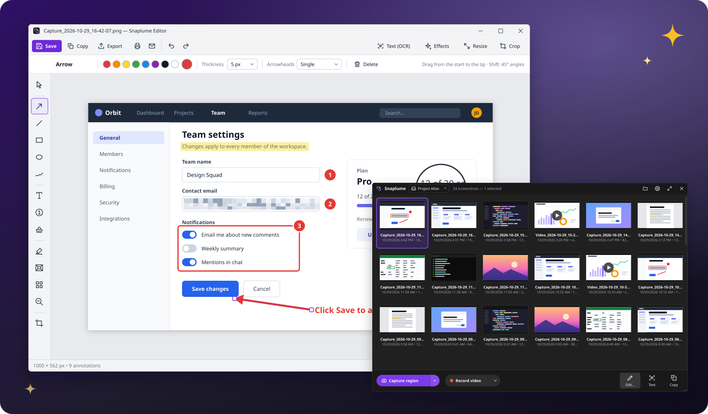
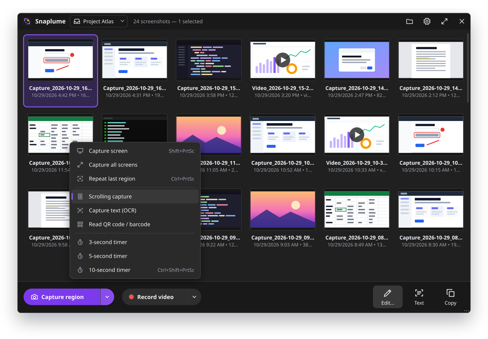
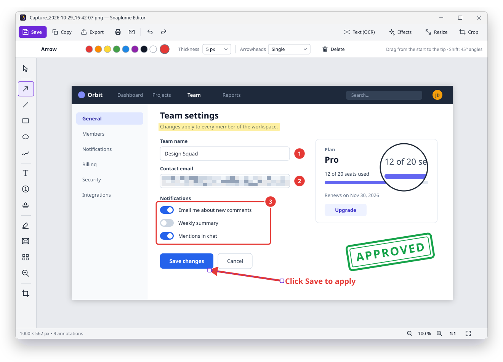
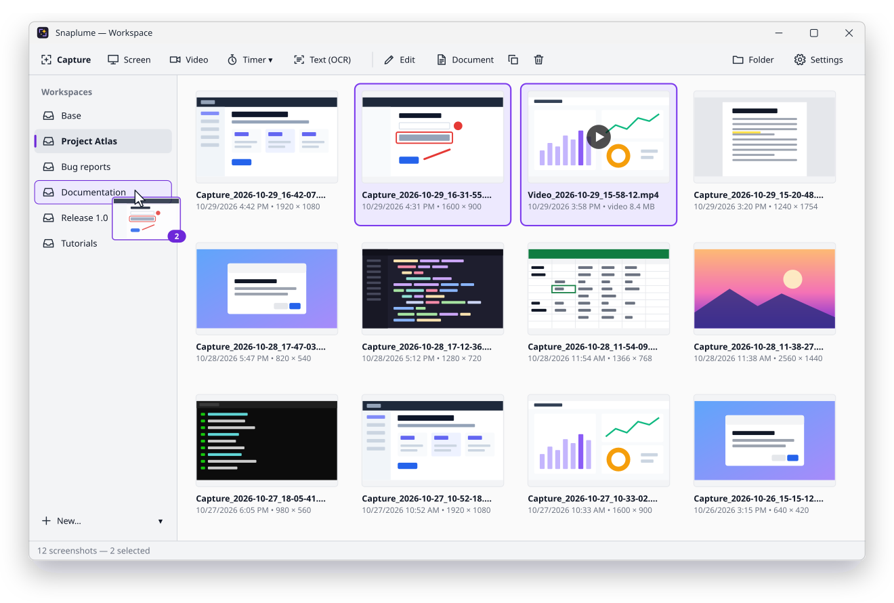
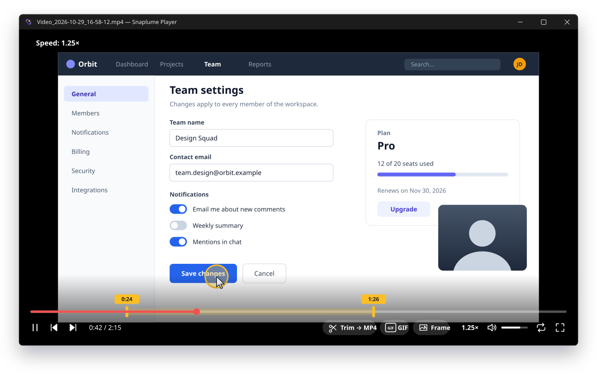
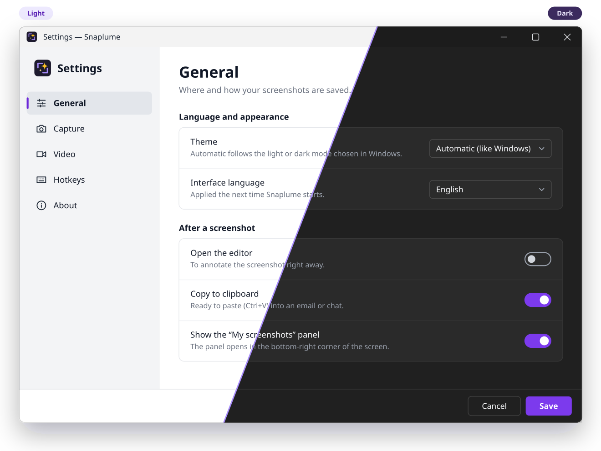

<div align="center">


# Snaplume

**Captures d'écran, annotations et enregistrement vidéo pour Windows et Linux, libres et gratuits. 100 % hors ligne.**

[](LICENSE)
[](#télécharger)
[](https://dotnet.microsoft.com/)
[](https://github.com/MrDDream/Snaplume/releases/latest)
[](#langues-et-thèmes)

[English](README.md) | Français

[**Télécharger**](https://github.com/MrDDream/Snaplume/releases/latest) · [Site web](https://mrddream.github.io/Snaplume/fr/) · [Fonctionnalités](#fonctionnalités) · [Raccourcis](#raccourcis-par-défaut) · [Compiler](#compiler-depuis-les-sources)



</div>

## Pourquoi Snaplume

- **Une seule petite application pour tout faire.** Capturer, annoter, enregistrer, ranger et partager sans jongler entre trois outils, sous Windows et Linux.
- **Rapide par défaut.** Appuyez sur <kbd>Impr. écran</kbd>, cliquez sur une fenêtre ou tracez une zone : la capture est déjà enregistrée, nommée et dans votre galerie.
- **Des annotations qui restent modifiables.** Rouvrez une capture le lendemain pour déplacer une flèche, corriger une faute ou renuméroter des étapes.
- **Respect de la vie privée.** Pas de compte, pas de cloud, pas de télémétrie, pas de publicité. Vos captures ne quittent jamais votre PC.
- **Gratuit, pour toujours.** Sous licence MIT, développé en C# / .NET 10 / Avalonia.

## Fonctionnalités

### Capture

- **Sélection intelligente** : le curseur devient un viseur, les fenêtres et éléments (boutons, panneaux, menus…) survolés sont détectés. Glissez pour une zone libre, cliquez pour l'élément survolé, tournez la molette pour passer à l'élément parent.
- **Loupe** avec coordonnées et couleur du pixel (`#RRGGBB`) ; les flèches du clavier déplacent le viseur au pixel près pour une sélection exacte.
- **Écran entier, tous les écrans, fenêtre active** et **répétition de la dernière zone** d'une seule touche.
- **Retardateur** (3, 5 ou 10 s depuis les menus ; le délai du raccourci se règle dans les Paramètres) pour capturer menus contextuels et info-bulles.
- **Capture défilante** : Snaplume fait défiler la fenêtre et assemble une seule grande image.
- **Capture de texte (OCR)** : sélectionnez une zone, son texte part dans le presse-papiers, grâce au moteur OCR de Windows (Tesseract sous Linux), hors ligne.
- **Lecture de QR codes et de codes-barres**, hors ligne, depuis l'écran ou une capture.
- **Win+Maj+S pour Snaplume** (option) : le raccourci de Windows ouvre la capture de zone de Snaplume au lieu de l'Outil Capture.
- Multi-écrans et hauts DPI (Per-Monitor v2) : des captures exactes au pixel sur chaque écran.

### Éditeur

- **Formes** : flèches (simple, double ou sans pointe), lignes, rectangles, ellipses, crayon à main levée. <kbd>Maj</kbd> pour les angles à 45°, les carrés et les cercles.
- **Texte** avec halo de lisibilité ou fond plein.
- **Numéros d'étapes** : chaque clic ajoute le numéro ou la lettre suivante, en cinq styles (rond, rond avec repère, bulle, épingle, rond sombre).
- **54 tampons vectoriels** : symboles (validé, refusé, attention, bug…), tampons de texte (APPROUVÉ, CONFIDENTIEL, BROUILLON…) et curseurs de souris.
- **Surligneur, pixelisation, projecteur, loupe** pour guider le regard et masquer ce qui doit rester privé.
- **Insertion d'images, comme dans Paint** : collez (<kbd>Ctrl</kbd>+<kbd>V</kbd>), ouvrez un fichier, glissez-déposez ou faites une nouvelle capture d'une zone, puis déplacez et redimensionnez l'image avant de la fixer. Posée à côté de la capture, elle l'agrandit pour contenir les deux.
- **Recadrage, redimensionnement** (pixels ou pourcentage), **bordures** en un clic (contour noir, cadre blanc, ombre, coins arrondis, bords déchirés, avec un aperçu de votre capture) et **effets** plus fins. Coins arrondis, bords déchirés et ombres restent **transparents** en PNG et WebP.
- **Styles prédéfinis par outil** : un clic sur un outil propose ses styles ; ajoutez les vôtres.
- Annuler / rétablir (jusqu'à 100 étapes), et des annotations **toujours modifiables** après enregistrement.
- Export en **PNG, JPEG, WebP ou BMP**, **impression** et **envoi par e-mail** avec votre messagerie locale.

### Vidéo

- **Enregistrement** d'une zone (ou de l'emplacement d'une fenêtre) ou d'un écran entier. Avant de démarrer, une barre permet de choisir le **micro**, le **son de l'ordinateur**, la **webcam** (caméra, coin, taille), le **zoom sur les clics** (la vidéo s'approche un instant de l'endroit cliqué) et la **taille de la zone** (1280 × 720, 1920 × 1080…) avec un cadre déplaçable ; puis compte à rebours de 3 secondes, pause et reprise.
- **Clics mis en évidence** et **webcam en incrustation** ; les barres flottantes et le cadre rouge restent hors de la vidéo.
- **Format et compression des enregistrements** (Paramètres › Vidéo) : MP4 H.264, ou H.265 enregistré directement si le PC a un encodeur ; AV1 et WebM sont convertis juste après l'enregistrement ; une qualité ou une **taille maximale** (Discord 10 Mo, e-mail 20 Mo, votre taille).
- **Lecteur intégré** façon mpv : fenêtre noire épurée, messages à l'écran, tout au clavier.
- **Découpe** (points d'entrée / de sortie) et export de l'extrait en MP4, conversion d'une vidéo ou d'un extrait en **GIF** animé (images par seconde, taille, vitesse, boucle), ou enregistrement de l'**image affichée** comme capture.
- **Exporter / compresser** (<kbd>C</kbd> dans le lecteur) : MP4 H.264, H.265, AV1, WebM ou WebP animé, sous une taille maximale : Snaplume baisse la définition et la fluidité plutôt que de flouter l'image, et prévient à l'avance quand une vidéo est trop longue pour cette taille.
- **Module ffmpeg optionnel** pour les formats web : téléchargé à la demande depuis Paramètres › Vidéo (environ 81 Mo, version LGPL), vérifié avec une empreinte SHA-256 inscrite dans Snaplume avant installation ; un ffmpeg déjà présent dans le PATH est utilisé tel quel. Sous Linux, c'est le ffmpeg du système.

### Organiser et partager

- **Panneau « Mes captures »** collé à la barre des tâches dans le coin de l'écran, avec les **espaces de travail dans un panneau latéral**, et une grande **fenêtre d'espace de travail**.
- **Espaces de travail** = des dossiers : sous-dossiers du dossier des captures par défaut, ou **n'importe quel dossier de votre choix** (autre disque, dossier de projet, partage réseau). Créer, renommer, changer de dossier, retirer, et déplacer les captures par glisser-déposer ; retirer un espace qui a son propre dossier n'efface jamais vos fichiers.
- Glissez les captures dans un mail, une messagerie ou un document ; déposez des images pour les importer.
- **Générateur de documents** : transformez une sélection de captures en document **PDF, Word (DOCX) ou HTML**, dans l'ordre de votre choix.
- **Impression** d'une sélection (une capture par page, chaque page dans l'orientation de son image) ou **envoi par e-mail** avec votre messagerie.
- Noms de fichiers automatiques, PNG, JPEG ou WebP, dossier configurable (par défaut : `Images\Snaplume`).
- **Mises à jour** : Snaplume peut vérifier s'il existe une nouvelle version, puis la télécharger et l'installer (installeur, MSI, copie portable, .deb ou .rpm), le fichier étant vérifié avant usage.

### Langues et thèmes

- **6 langues** : anglais, français, allemand, espagnol, italien et arabe (interface de droite à gauche).
- Thème **clair, sombre ou automatique**, qui suit le système même pendant l'utilisation.
- **Mode portable**, **installeur** (lancement au démarrage de Windows coché par défaut), **paquets Linux**, icône de notification, raccourcis globaux configurables, navigation au clavier et **ligne de commande** scriptable.

## Aperçus

> Les images ci-dessous sont des maquettes vectorielles dessinées d'après l'interface réelle (couleurs, disposition, libellés), nettes à toutes les tailles. L'interface est montrée en anglais ; elle s'affiche en français sur un Windows en français.

<table>
  <tr>
    <td width="50%"></td>
    <td width="50%"></td>
  </tr>
  <tr>
    <td align="center"><b>Panneau rapide</b> : capturer, enregistrer, éditer, lire le texte, copier.</td>
    <td align="center"><b>Éditeur</b> : flèches, étapes, tampons, pixelisation, loupe…</td>
  </tr>
  <tr>
    <td></td>
    <td></td>
  </tr>
  <tr>
    <td align="center"><b>Espaces de travail</b> : un sous-dossier par projet, glisser-déposer.</td>
    <td align="center"><b>Lecteur</b> : découpe, export GIF et image.</td>
  </tr>
  <tr>
    <td colspan="2"></td>
  </tr>
  <tr>
    <td colspan="2" align="center"><b>Thèmes clair et sombre</b>, ou automatique comme Windows.</td>
  </tr>
</table>

## Télécharger

Récupérez la dernière version sur la [**page des versions**](https://github.com/MrDDream/Snaplume/releases/latest) :

| Paquet | Fichier | Pour qui |
|---|---|---|
| **Installeur** | `Snaplume-Setup-<version>.exe` | La plupart des utilisateurs : installation classique avec raccourci dans le menu Démarrer et désinstalleur. |
| **Portable** | `Snaplume-<version>-portable.zip` | Clés USB et PC verrouillés : décompressez n'importe où et lancez `Snaplume.exe` ; les paramètres restent dans le dossier. |
| **MSI** | `Snaplume-<version>-x64.msi` | Services informatiques : installation pour tous les utilisateurs dans `Program Files`, via Intune, une stratégie de groupe ou `msiexec /i Snaplume-<version>-x64.msi /qn` (`DESKTOPSHORTCUT=1` ajoute un raccourci sur le bureau). |
| **Linux (Debian, Ubuntu…)** | `snaplume_<version>-1_amd64.deb` (ou `arm64`) | `sudo apt install ./snaplume_<version>-1_amd64.deb` : les dépendances (GStreamer, ffmpeg, Tesseract…) sont installées avec. |
| **Linux (Fedora…)** | `snaplume-<version>-1.x86_64.rpm` (ou `aarch64`) | `sudo dnf install ./snaplume-<version>-1.x86_64.rpm`. |

Tous sont autonomes : **aucune installation de .NET n'est nécessaire**. Chaque version publie aussi `SHA256SUMS.txt` (Windows) et `SHA256SUMS-linux.txt` pour vérifier les téléchargements.

**Configuration requise** : Windows 10 version 2004 (mise à jour de mai 2020) ou plus récent, ou Windows 11, 64 bits (x64) ; ou une distribution Linux récente (session X11 ou Wayland), x64 ou arm64.

> [!NOTE]
> **Linux sous Wayland** (par défaut sous Ubuntu et Fedora) : les captures, la capture défilante et les vidéos passent par les portails du système, qui demandent votre autorisation la première fois. Les fenêtres ne sont pas détectées sous la souris (sélection par glisser), les clics ne peuvent pas être mis en évidence dans les vidéos, et les raccourcis globaux demandent KDE ou GNOME 48+ (ailleurs, liez un raccourci du système à `snaplume --capture region`). Sous GNOME, l'icône de notification demande l'extension AppIndicator. Une session X11 a toutes les fonctions.

> [!NOTE]
> Les exécutables ne sont pas encore signés : au premier lancement, Windows SmartScreen peut afficher *« Windows a protégé votre ordinateur »*. Cliquez sur **Informations complémentaires › Exécuter quand même**. Vous pouvez vérifier le fichier avec `SHA256SUMS.txt`, ou [le compiler vous-même](#compiler-depuis-les-sources).

**Mode portable** : un fichier vide nommé `portable` à côté de `Snaplume.exe` (déjà présent dans le zip) garde les paramètres dans ce dossier au lieu de `%APPDATA%\Snaplume`.

## Raccourcis par défaut

### Globaux (modifiables dans Paramètres › Raccourcis clavier)

| Action | Raccourci |
|---|---|
| Zone, fenêtre ou élément | <kbd>Impr. écran</kbd> |
| Écran entier (sous la souris) | <kbd>Maj</kbd> + <kbd>Impr. écran</kbd> |
| Fenêtre active | <kbd>Alt</kbd> + <kbd>Impr. écran</kbd> |
| Répéter la dernière zone | <kbd>Ctrl</kbd> + <kbd>Impr. écran</kbd> |
| Zone avec retardateur | <kbd>Ctrl</kbd> + <kbd>Maj</kbd> + <kbd>Impr. écran</kbd> |
| Démarrer / arrêter une vidéo | <kbd>Ctrl</kbd> + <kbd>Alt</kbd> + <kbd>Impr. écran</kbd> |
| Capturer du texte (OCR) | aucun par défaut, à définir dans les paramètres |

> [!TIP]
> Un raccourci ne peut appartenir qu'à une seule application. Si un autre outil (Outil Capture de Windows, OneDrive, Dropbox…) utilise déjà <kbd>Impr. écran</kbd>, Snaplume vous prévient. Sous Windows 11, désactivez aussi *Paramètres › Accessibilité › Clavier › Utiliser la touche Impr. écran pour ouvrir la capture d'écran*. Pour utiliser <kbd>Win</kbd>+<kbd>Maj</kbd>+<kbd>S</kbd> avec Snaplume, activez l'option dans Paramètres › Raccourcis clavier.

### Pendant la sélection d'une zone

<kbd>Glisser</kbd> zone libre · <kbd>Clic</kbd> ou <kbd>Entrée</kbd> fenêtre ou élément survolé · <kbd>Molette</kbd> élément parent / enfant · <kbd>F</kbd> écran entier · <kbd>A</kbd> tous les écrans · <kbd>Flèches</kbd> déplacer le viseur de 1 px (<kbd>Maj</kbd> 10 px) · <kbd>Échap</kbd> ou clic droit annuler

### Éditeur

| Outil | Touche | Outil | Touche | Outil | Touche |
|---|---|---|---|---|---|
| Sélection | <kbd>V</kbd> | Texte | <kbd>T</kbd> | Projecteur | <kbd>O</kbd> |
| Flèche | <kbd>A</kbd> | Numéros d'étapes | <kbd>N</kbd> | Pixeliser | <kbd>B</kbd> |
| Ligne | <kbd>L</kbd> | Tampons | <kbd>S</kbd> | Loupe | <kbd>M</kbd> |
| Rectangle | <kbd>R</kbd> | Crayon | <kbd>P</kbd> | Recadrer | <kbd>C</kbd> |
| Ellipse | <kbd>E</kbd> | Surligneur | <kbd>H</kbd> | | |

<kbd>Ctrl</kbd>+<kbd>S</kbd> enregistrer · <kbd>Ctrl</kbd>+<kbd>Maj</kbd>+<kbd>S</kbd> exporter · <kbd>Ctrl</kbd>+<kbd>C</kbd> copier · <kbd>Ctrl</kbd>+<kbd>P</kbd> imprimer · <kbd>Ctrl</kbd>+<kbd>R</kbd> redimensionner · <kbd>Ctrl</kbd>+<kbd>Z</kbd> / <kbd>Ctrl</kbd>+<kbd>Y</kbd> (ou <kbd>Ctrl</kbd>+<kbd>Maj</kbd>+<kbd>Z</kbd>) annuler / rétablir · <kbd>Ctrl</kbd>+<kbd>Molette</kbd>, <kbd>Ctrl</kbd>+<kbd>+</kbd> / <kbd>Ctrl</kbd>+<kbd>-</kbd> zoom · <kbd>Ctrl</kbd>+<kbd>0</kbd> 100 % · <kbd>Flèches</kbd> déplacer l'annotation sélectionnée de 1 px (<kbd>Maj</kbd> 10 px) · <kbd>Suppr</kbd> supprimer

### Lecteur vidéo

<kbd>Espace</kbd> ou <kbd>P</kbd> lecture / pause · <kbd>←</kbd> <kbd>→</kbd> ±5 s (<kbd>Maj</kbd> ±1 s) · <kbd>↑</kbd> <kbd>↓</kbd> ±1 min · <kbd>Début</kbd> retour au début · <kbd>,</kbd> <kbd>.</kbd> image précédente / suivante · <kbd>[</kbd> <kbd>]</kbd> vitesse (<kbd>Maj</kbd> diviser / multiplier par 2) · <kbd>Retour arrière</kbd> vitesse normale · <kbd>9</kbd> <kbd>0</kbd> volume · <kbd>M</kbd> muet · <kbd>L</kbd> boucle · <kbd>F</kbd> ou <kbd>Entrée</kbd> plein écran · <kbd>Échap</kbd> quitter le plein écran, annuler un export ou fermer

<kbd>I</kbd> / <kbd>O</kbd> début / fin de l'extrait (<kbd>Maj</kbd>+<kbd>I</kbd> / <kbd>Maj</kbd>+<kbd>O</kbd> effacer) · <kbd>E</kbd> exporter l'extrait (MP4) · <kbd>C</kbd> exporter / compresser (H.264, H.265, AV1, WebM, WebP, taille maximale) · <kbd>G</kbd> créer un GIF · <kbd>S</kbd> enregistrer l'image · <kbd>Ctrl</kbd>+<kbd>O</kbd> ouvrir dans le lecteur par défaut · <kbd>F1</kbd> aide · <kbd>Q</kbd> fermer

Souris : clic lecture / pause · double-clic plein écran · <kbd>Molette</kbd> ±10 s · <kbd>Ctrl</kbd>+<kbd>Molette</kbd> volume

## Ligne de commande

```text
Snaplume.exe [--tray] [--capture region|screen|all|window|repeat|text|scrolling|qr] [--delay N]
             [--workspace nom] [--record region|screen] [--duration N] [--exit]
             [--settings] [--window] [fichier]
```

| Option | Effet |
|---|---|
| `--tray` | Démarre discrètement dans la zone de notification. |
| `--capture <mode>` | Capture immédiatement : `region` (zone), `screen` (écran), `all` (tous les écrans), `window` (fenêtre active), `repeat` (dernière zone), `text` (OCR), `scrolling` (défilante), `qr` (QR code). |
| `--delay N` | Attend N secondes avant la capture. |
| `--workspace nom` | Enregistre dans cet espace de travail (créé si besoin). |
| `--record region\|screen` | Démarre un enregistrement vidéo. |
| `--duration N` | Arrête l'enregistrement après N secondes. |
| `--exit` | Quitte une fois la capture ou l'enregistrement terminé. |
| `--settings` / `--window` | Ouvre les paramètres / la fenêtre d'espace de travail. |
| `fichier` | Ouvre une image dans l'éditeur ou une vidéo dans le lecteur. |

Si Snaplume est déjà lancé, la commande est transmise à l'instance ouverte (par un canal réservé à l'utilisateur courant).

```powershell
Snaplume.exe --capture screen --exit                                # une capture puis quitter
Snaplume.exe --capture region --delay 5 --workspace "Projet client" # zone après 5 s, dans un espace
Snaplume.exe --record screen --duration 30 --exit                   # vidéo de l'écran de 30 s
```

## Vie privée

Snaplume fonctionne **100 % hors ligne** :

- pas de compte, pas de connexion, pas d'envoi dans le cloud, pas de télémétrie, pas de statistiques, pas de publicité ;
- le réseau n'est utilisé qu'à votre demande, et uniquement avec GitHub :
  - la **vérification des mises à jour** (Paramètres › À propos, ou sa vérification quotidienne, désactivée par défaut) demande la dernière version et n'envoie rien d'autre ;
  - « Télécharger et installer » récupère le paquet adapté à votre installation (installeur, MSI, zip portable, .deb ou .rpm) depuis les versions du projet, dans un dossier qui n'appartient qu'à vous, et vérifie son empreinte SHA-256 avec la liste publiée, une nouvelle fois juste avant de l'installer ;
  - le **module ffmpeg** optionnel n'est téléchargé que si vous cliquez sur Installer, et vérifié avec une empreinte SHA-256 inscrite dans Snaplume ;
- l'OCR utilise le moteur de reconnaissance de texte intégré à Windows (Tesseract sous Linux), les QR codes sont décodés localement ;
- l'e-mail passe par **votre** logiciel de messagerie, le générateur de documents écrit des fichiers locaux ;
- les captures sont de simples fichiers dans le dossier de votre choix (par défaut `Images\Snaplume`), les paramètres un fichier JSON dans `%APPDATA%\Snaplume` (ou à côté de l'application en mode portable).

## Compiler depuis les sources

Prérequis : le [SDK .NET 10](https://dotnet.microsoft.com/download). L'interface utilise [Avalonia](https://avaloniaui.net/) : le même code tourne sous Windows et Linux.

```powershell
git clone https://github.com/MrDDream/Snaplume.git
cd Snaplume
dotnet build Snaplume.slnx
dotnet test tests/Snaplume.Tests
# Windows
dotnet run --project src/Snaplume.App -f net10.0-windows10.0.19041.0
# Linux
dotnet run --project src/Snaplume.App -f net10.0
```

Paquets de version (zip portable, installeur, MSI et `SHA256SUMS.txt` dans `artifacts/`) :

```powershell
pwsh build/build-release.ps1
# ou, avec Windows PowerShell 5.1 :
powershell -ExecutionPolicy Bypass -File build\build-release.ps1
```

L'installeur nécessite [Inno Setup 6](https://jrsoftware.org/isinfo.php) et le MSI [WiX Toolset 5](https://wixtoolset.org/) (`dotnet tool install --global wix --version 5.0.2`) ; chaque étape est ignorée si son outil n'est pas installé. Le MSI demande aussi les DLL du runtime Visual C++ d'une installation de Visual Studio (déploiement local). L'enregistrement vidéo s'appuie sur le runtime Microsoft Visual C++ 2015-2022 x64, que le script de version inclut. L'icône de l'application est générée par `tools/make-icon.ps1`.

Paquets Linux (`.deb` et `.rpm`, x64 et arm64, dans `artifacts/linux/`), depuis Windows ou Linux avec [nfpm](https://nfpm.goreleaser.com/) :

```powershell
pwsh build/build-linux.ps1
```

Les dépendances sont décrites dans [packaging/linux/README.md](packaging/linux/README.md).

## Structure du projet

```text
Snaplume.slnx
src/Snaplume.Core/              code commun à tous les systèmes (net10.0)
  Editor/       modèle d'annotations, rendu, effets et bordures, loupe, tampons, styles, annuler/rétablir
  Capturing/    capture défilante et recollage, modèle de sélection et géométrie
  Player/       export vidéo : GIF, formats web, taille maximale, module ffmpeg, formats d'enregistrement
  Recording/    zoom sur les clics, encodeur GIF
  Export/       générateur de documents (PDF, Word, HTML)
  Imaging/      images en mémoire, fichiers image, contours de texte (SkiaSharp, HarfBuzz)
  Platform/     interfaces des services fournis par chaque système
  Languages/    traductions de l'interface, un fichier JSON par langue
  Core/         paramètres, espaces de travail, traductions, fichiers, ligne de commande, mises à jour
src/Snaplume.App/               l'interface Avalonia (versions Windows et Linux)
  Editor/ Capturing/ Recording/ Player/ Workspace/ Preferences/ Ocr/ Qr/ Export/ Themes/ Ui/
src/Snaplume.Platform.Windows/  Win32, WinRT (OCR, vidéo), ScreenRecorderLib, MAPI, impression
src/Snaplume.Platform.Linux/    X11, portails Wayland (D-Bus), GStreamer, ffmpeg, Tesseract
tests/Snaplume.Tests/           tests xUnit, rendu Avalonia sans écran
build/          scripts de version (Windows : zip, Inno Setup, MSI ; Linux : .deb/.rpm), sommes de contrôle
packaging/linux/                configuration nfpm, fichier .desktop, métadonnées AppStream, icônes
packaging/winget/               manifestes winget et marche à suivre pour les soumettre
docs/           site web (GitHub Pages), maquettes et identité visuelle
tools/          générateur d'icône
```

## Feuille de route

La version 1.2 apporte tout ce qui est décrit ci-dessus. Pistes pour la suite, contributions bienvenues :

- [x] Version Linux (.deb et .rpm, x64 et ARM64)
- [ ] Paquet winget (manifestes prêts dans `packaging/winget`) et Scoop
- [ ] Exécutables signés (fini l'avertissement SmartScreen)
- [ ] Davantage de langues d'interface
- [ ] Version Windows ARM64

Les services en ligne (envoi, liens de partage, comptes) sont **volontairement exclus**.

## Contribuer

Signalements de bugs, traductions et pull requests sont les bienvenus : voir [CONTRIBUTING.md](CONTRIBUTING.md). Pour ajouter une langue, copiez `src/Snaplume.Core/Languages/en.json`, traduisez les valeurs, déclarez la langue dans `src/Snaplume.Core/Core/Loc.cs` et dans `build/build-release.ps1`, puis proposez une pull request (détails dans CONTRIBUTING.md).

## Remerciements

Snaplume s'appuie sur ces projets libres :

| Projet | Utilisé pour | Licence |
|---|---|---|
| [Avalonia](https://avaloniaui.net/) | interface sous Windows et Linux | MIT |
| [SkiaSharp](https://github.com/mono/SkiaSharp) et HarfBuzzSharp | fichiers image, dessin, mise en forme du texte | MIT |
| [ScreenRecorderLib](https://github.com/sskodje/ScreenRecorderLib) | enregistrement d'écran sous Windows (Media Foundation) | MIT |
| [GStreamer](https://gstreamer.freedesktop.org/) | enregistrement et lecture vidéo sous Linux (paquets du système) | LGPL |
| [FFmpeg](https://ffmpeg.org/) | formats web et compression (module optionnel, [version LGPL de BtbN](https://github.com/BtbN/FFmpeg-Builds) sous Windows ; paquet du système sous Linux) | LGPL |
| [Tesseract](https://github.com/tesseract-ocr/tesseract) | reconnaissance de texte sous Linux (paquet du système) | Apache-2.0 |
| [Tmds.DBus.Protocol](https://github.com/tmds/Tmds.DBus) | portails du bureau et notifications sous Linux | MIT |
| [ZXing.Net](https://github.com/micjahn/ZXing.Net) | lecture de QR codes et codes-barres | Apache-2.0 |
| [Open XML SDK](https://github.com/dotnet/Open-XML-SDK) | génération de documents DOCX | MIT |
| [Inno Setup](https://jrsoftware.org/isinfo.php) | installeur Windows | licence Inno Setup |
| [WiX Toolset](https://wixtoolset.org/) | paquet MSI | MS-RL |
| [nfpm](https://nfpm.goreleaser.com/) | paquets .deb et .rpm | MIT |

Les fichiers PDF sont écrits par le module PDF propre à Snaplume, et la reconnaissance de texte utilise le moteur OCR intégré à Windows (`Windows.Media.Ocr`) ou Tesseract sous Linux. Les fonctionnalités s'inspirent de Screenpresso ; Snaplume est un projet indépendant, sans aucune affiliation.

## Licence

[MIT](LICENSE) © contributeurs de Snaplume. Libre d'utilisation, y compris commerciale.
