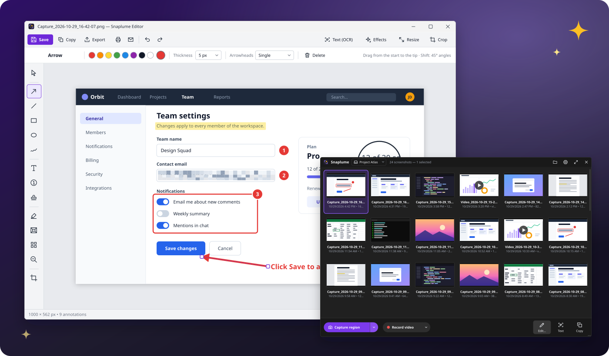
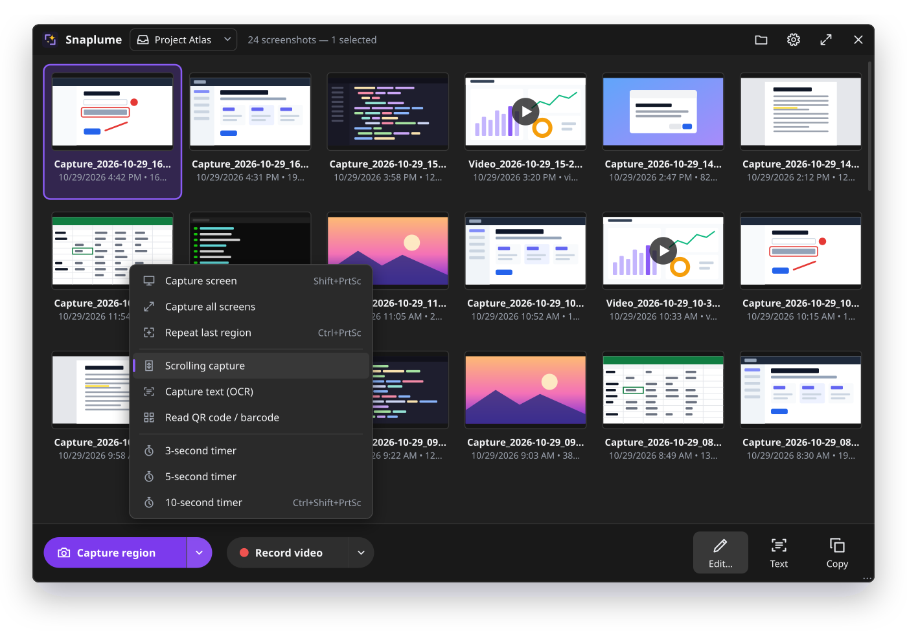
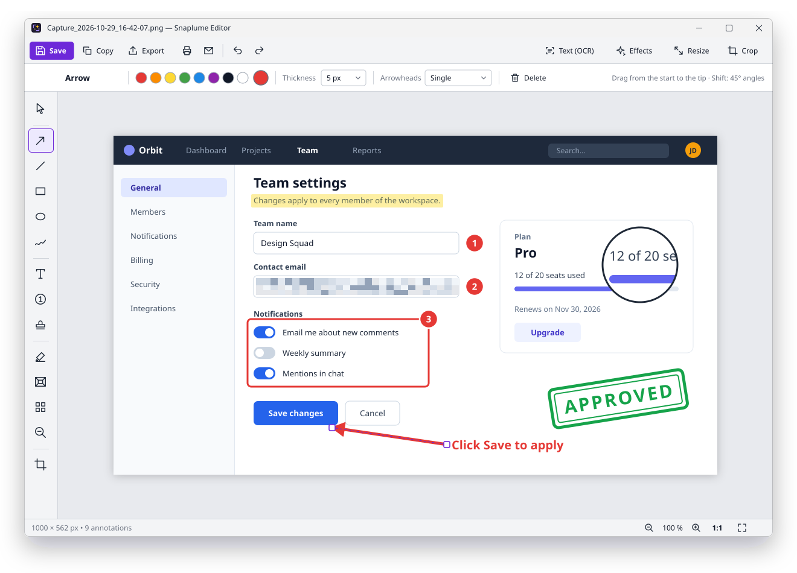
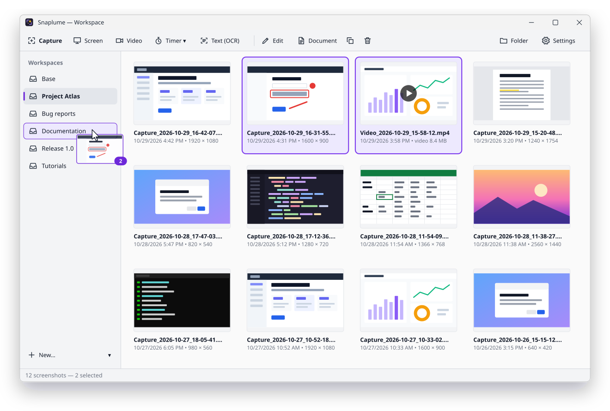
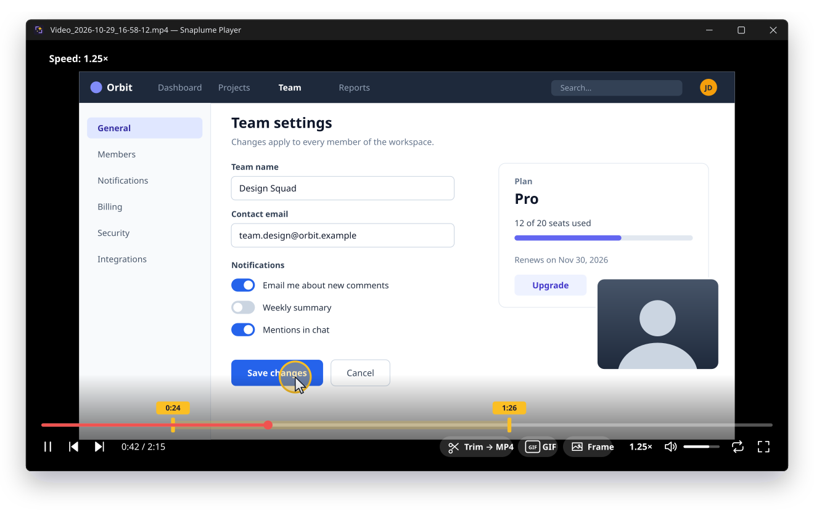
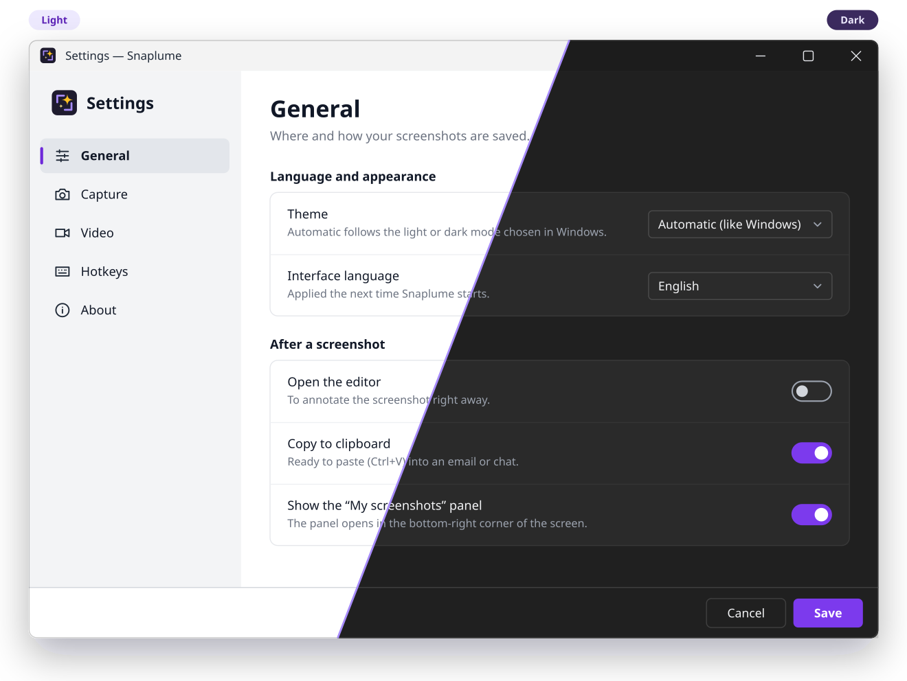

<div align="center">


# Snaplume

**Free, open-source screenshots, annotations and screen recording for Windows. 100% offline.**

[](LICENSE)
[](#download)
[](https://dotnet.microsoft.com/)
[](https://github.com/MrDDream/Snaplume/releases/latest)
[](#languages-and-themes)

English | [Français](README.fr.md)

[**Download**](https://github.com/MrDDream/Snaplume/releases/latest) · [Website](https://mrddream.github.io/Snaplume/) · [Features](#features) · [Shortcuts](#default-shortcuts) · [Build from source](#build-from-source)



</div>

## Why Snaplume

- **One small app for the whole job.** Capture, annotate, record, organize and share without juggling three tools.
- **Fast by default.** Press <kbd>Print Screen</kbd>, click a window or drag a region, and the capture is already saved, named and in your gallery.
- **Annotations stay editable.** Reopen a capture tomorrow and move that arrow, fix that typo or renumber those steps.
- **Private by design.** No account, no cloud, no telemetry, no ads. Your screenshots never leave your PC.
- **Free forever.** MIT licensed, built in the open with C# / .NET 10 / WPF.

## Features

### Capture

- **Smart region selection**: the cursor becomes a crosshair, windows and controls (buttons, panels, menus…) are detected under the mouse. Drag for a free region, click for the hovered element, scroll the wheel to go up to the parent element.
- **Magnifier** with pixel coordinates and the color under the cursor (`#RRGGBB`); arrow keys move the crosshair pixel by pixel for an exact selection.
- **Full screen, all screens, active window**, and **repeat last region** in one keystroke.
- **Timer** (3, 5 or 10 s from the menus; the delay of the timer hotkey is set in Settings) to catch context menus and tooltips.
- **Scrolling capture**: Snaplume scrolls the window for you and stitches a single tall image.
- **Text capture (OCR)**: select an area and its text goes to the clipboard, using the offline Windows OCR engine.
- **QR code and barcode reading**, offline, from the screen or from any capture.
- Multi-monitor and high-DPI aware (Per-Monitor v2): captures are pixel-exact on every screen.

### Editor

- **Shapes**: arrows (single head, double head or no head), lines, rectangles, ellipses, freehand pen. <kbd>Shift</kbd> snaps to 45°, squares and circles.
- **Text** with a readability halo or a solid background.
- **Step numbers**: each click adds the next number or letter, in five styles (circle, circle with leader, bubble, pin, dark).
- **54 vector stamps**: symbols (approved, rejected, warning, bug…), text stamps (APPROVED, CONFIDENTIAL, DRAFT…) and mouse cursors.
- **Highlighter, pixelate, spotlight, magnifier** to guide the eye and hide what must stay private.
- **Insert images, like in Paint**: paste (<kbd>Ctrl</kbd>+<kbd>V</kbd>), open a file, drag and drop, or take a new capture of an area, then move and resize it before it is placed. Drop it beside the capture and the capture grows to hold both.
- **Crop, resize** (pixels or percent), and **effects**: shadow, border, rounded corners, torn edge.
- **Presets per tool**: one click on a tool offers its saved styles; add your own.
- Undo / redo (up to 100 steps), and annotations that **stay editable** after saving.
- Export to **PNG, JPEG or BMP**, **print**, or **send by e-mail** through your local mail client.

### Video

- **MP4 recording** of a region (or the area of a window) or a full screen, with **system audio and/or microphone**, after a 3-second countdown; pause and resume from the control bar.
- **Click highlighting** and a **webcam overlay**; the floating control bar and the red frame are kept out of the video.
- **Built-in player** inspired by mpv: minimal black window, on-screen messages, keyboard-driven.
- **Trim** (in / out points) and export the extract to MP4, turn a video or an extract into an animated **GIF** (frame rate, size, speed, loop), or save the current **frame** as a screenshot.

### Organize and share

- **"My screenshots" panel** docked in the corner of the screen, and a full **workspace window**.
- **Workspaces** are plain sub-folders: create, rename, delete, and move captures between them by drag and drop.
- Drag captures straight into mail, chat or documents; drop images in to import them.
- **Document generator**: turn a selection of captures into a **PDF, Word (DOCX) or HTML** document, in the order you choose.
- **Print** a selection (one capture per page, each page in the orientation of its image) or **e-mail** it through your mail client.
- Automatic file names, PNG or JPEG, configurable folder (default: `Pictures\Snaplume`).

### Languages and themes

- **6 languages**: English, French, German, Spanish, Italian and Arabic (with a right-to-left interface).
- **Light, dark or automatic** theme, following Windows even while the app is running.
- **Portable mode**, **installer**, tray icon, configurable global hotkeys, start with Windows, and a scriptable **command line**.

## Screenshots

> The pictures below are vector mockups drawn from the real interface (colors, layout and labels), so they stay sharp in any size and theme.

<table>
  <tr>
    <td width="50%"></td>
    <td width="50%"></td>
  </tr>
  <tr>
    <td align="center"><b>Quick panel</b>: capture, record, edit, read text, copy.</td>
    <td align="center"><b>Editor</b>: arrows, steps, stamps, pixelate, magnifier…</td>
  </tr>
  <tr>
    <td></td>
    <td></td>
  </tr>
  <tr>
    <td align="center"><b>Workspaces</b>: one sub-folder per project, drag and drop.</td>
    <td align="center"><b>Player</b>: trim, GIF and frame export.</td>
  </tr>
  <tr>
    <td colspan="2"></td>
  </tr>
  <tr>
    <td colspan="2" align="center"><b>Light and dark themes</b>, or automatic like Windows.</td>
  </tr>
</table>

## Download

Get the latest version from the [**Releases page**](https://github.com/MrDDream/Snaplume/releases/latest):

| Package | File | Best for |
|---|---|---|
| **Installer** | `Snaplume-Setup-<version>.exe` | Most users: classic setup with a Start menu shortcut and an uninstaller. |
| **Portable** | `Snaplume-<version>-portable.zip` | USB sticks and locked-down PCs: unzip anywhere and run `Snaplume.exe`; settings stay in the folder. |
| **MSI** | `Snaplume-<version>-x64.msi` | IT departments: all-users installation in `Program Files`, for Intune, Group Policy or `msiexec /i Snaplume-<version>-x64.msi /qn` (`DESKTOPSHORTCUT=1` adds a desktop shortcut). |

All are self-contained: **no .NET installation needed**. Each release also ships a `SHA256SUMS.txt` file to verify the downloads.

**Requirements**: Windows 10 version 2004 (May 2020 Update) or later, or Windows 11, 64-bit (x64).

> [!NOTE]
> The builds are not code-signed yet, so Windows SmartScreen may show *"Windows protected your PC"* the first time. Click **More info › Run anyway**. You can check the file against `SHA256SUMS.txt`, or [build it yourself](#build-from-source).

**Portable mode**: an empty file named `portable` next to `Snaplume.exe` (already included in the zip) keeps the settings in that folder instead of `%APPDATA%\Snaplume`.

## Default shortcuts

### Global (configurable in Settings › Hotkeys)

| Action | Shortcut |
|---|---|
| Region, window or element | <kbd>Print Screen</kbd> |
| Full screen (under the mouse) | <kbd>Shift</kbd> + <kbd>Print Screen</kbd> |
| Active window | <kbd>Alt</kbd> + <kbd>Print Screen</kbd> |
| Repeat last region | <kbd>Ctrl</kbd> + <kbd>Print Screen</kbd> |
| Region with timer | <kbd>Ctrl</kbd> + <kbd>Shift</kbd> + <kbd>Print Screen</kbd> |
| Start / stop video recording | <kbd>Ctrl</kbd> + <kbd>Alt</kbd> + <kbd>Print Screen</kbd> |
| Capture text (OCR) | none by default, set it in Settings |

> [!TIP]
> A hotkey can belong to only one application. If another tool (Windows Snipping Tool, OneDrive, Dropbox…) already uses <kbd>Print Screen</kbd>, Snaplume tells you. On Windows 11, also turn off *Settings › Accessibility › Keyboard › Use the Print screen key to open screen capture*.

### While selecting a region

<kbd>Drag</kbd> free region · <kbd>Click</kbd> or <kbd>Enter</kbd> hovered window or element · <kbd>Wheel</kbd> parent / child element · <kbd>F</kbd> full screen · <kbd>A</kbd> all screens · <kbd>Arrows</kbd> move the crosshair by 1 px (<kbd>Shift</kbd> 10 px) · <kbd>Esc</kbd> or right click cancel

### Editor

| Tool | Key | Tool | Key | Tool | Key |
|---|---|---|---|---|---|
| Select | <kbd>V</kbd> | Text | <kbd>T</kbd> | Spotlight | <kbd>O</kbd> |
| Arrow | <kbd>A</kbd> | Step numbers | <kbd>N</kbd> | Pixelate | <kbd>B</kbd> |
| Line | <kbd>L</kbd> | Stamps | <kbd>S</kbd> | Magnifier | <kbd>M</kbd> |
| Rectangle | <kbd>R</kbd> | Pen | <kbd>P</kbd> | Crop | <kbd>C</kbd> |
| Ellipse | <kbd>E</kbd> | Highlighter | <kbd>H</kbd> | | |

<kbd>Ctrl</kbd>+<kbd>S</kbd> save · <kbd>Ctrl</kbd>+<kbd>Shift</kbd>+<kbd>S</kbd> export · <kbd>Ctrl</kbd>+<kbd>C</kbd> copy · <kbd>Ctrl</kbd>+<kbd>P</kbd> print · <kbd>Ctrl</kbd>+<kbd>R</kbd> resize · <kbd>Ctrl</kbd>+<kbd>Z</kbd> / <kbd>Ctrl</kbd>+<kbd>Y</kbd> (or <kbd>Ctrl</kbd>+<kbd>Shift</kbd>+<kbd>Z</kbd>) undo / redo · <kbd>Ctrl</kbd>+<kbd>Wheel</kbd>, <kbd>Ctrl</kbd>+<kbd>+</kbd> / <kbd>Ctrl</kbd>+<kbd>-</kbd> zoom · <kbd>Ctrl</kbd>+<kbd>0</kbd> 100 % · <kbd>Arrows</kbd> move the selected annotation by 1 px (<kbd>Shift</kbd> 10 px) · <kbd>Del</kbd> delete

### Video player

<kbd>Space</kbd> or <kbd>P</kbd> play / pause · <kbd>←</kbd> <kbd>→</kbd> ±5 s (<kbd>Shift</kbd> ±1 s) · <kbd>↑</kbd> <kbd>↓</kbd> ±1 min · <kbd>Home</kbd> back to the start · <kbd>,</kbd> <kbd>.</kbd> previous / next frame · <kbd>[</kbd> <kbd>]</kbd> speed (<kbd>Shift</kbd> halve / double) · <kbd>Backspace</kbd> normal speed · <kbd>9</kbd> <kbd>0</kbd> volume · <kbd>M</kbd> mute · <kbd>L</kbd> loop · <kbd>F</kbd> or <kbd>Enter</kbd> full screen · <kbd>Esc</kbd> leave full screen, cancel an export, or close

<kbd>I</kbd> / <kbd>O</kbd> start / end of the extract (<kbd>Shift</kbd>+<kbd>I</kbd> / <kbd>Shift</kbd>+<kbd>O</kbd> clear) · <kbd>E</kbd> export the extract (MP4) · <kbd>G</kbd> make a GIF · <kbd>S</kbd> save the frame · <kbd>Ctrl</kbd>+<kbd>O</kbd> open in the default player · <kbd>F1</kbd> help · <kbd>Q</kbd> close

Mouse: click play / pause · double-click full screen · <kbd>Wheel</kbd> ±10 s · <kbd>Ctrl</kbd>+<kbd>Wheel</kbd> volume

## Command line

```text
Snaplume.exe [--tray] [--capture region|screen|all|window|repeat|text|scrolling|qr] [--delay N]
             [--workspace name] [--record region|screen] [--duration N] [--exit]
             [--settings] [--window] [file]
```

| Option | Effect |
|---|---|
| `--tray` | Start quietly in the notification area. |
| `--capture <mode>` | Capture right away: `region`, `screen`, `all` screens, active `window`, `repeat` last region, `text` (OCR), `scrolling`, `qr` code. |
| `--delay N` | Wait N seconds before capturing. |
| `--workspace name` | Save into this workspace (created if needed). |
| `--record region\|screen` | Start a video recording. |
| `--duration N` | Stop the recording after N seconds. |
| `--exit` | Quit once the capture or recording is done. |
| `--settings` / `--window` | Open the settings / the workspace window. |
| `file` | Open an image in the editor or a video in the player. |

If Snaplume is already running, the command is handed to the running instance (through a channel reserved to the current user).

```powershell
Snaplume.exe --capture screen --exit                              # one screenshot, then quit
Snaplume.exe --capture region --delay 5 --workspace "Bug reports" # region after 5 s, in a workspace
Snaplume.exe --record screen --duration 30 --exit                 # 30-second screen video
```

## Privacy

Snaplume works **100% offline**:

- no account, no sign-in, no cloud upload, no telemetry, no analytics, no ads;
- the only network request is the **update check**, and only when you ask for it (Settings › About) or turn on its daily check (off by default); it asks GitHub for the latest version and sends nothing else;
- OCR uses the text recognition engine built into Windows, QR codes are decoded locally;
- e-mail goes through **your** mail client, and the document generator writes local files;
- captures are plain files in a folder you choose (default `Pictures\Snaplume`), settings are a JSON file in `%APPDATA%\Snaplume` (or next to the app in portable mode).

## Build from source

Requirements: Windows 10/11 x64 and the [.NET 10 SDK](https://dotnet.microsoft.com/download).

```powershell
git clone https://github.com/MrDDream/Snaplume.git
cd Snaplume
dotnet build Snaplume.slnx
dotnet run --project src/Snaplume
```

Release packages (portable zip, installer, MSI and `SHA256SUMS.txt` in `artifacts/`):

```powershell
pwsh build/build-release.ps1
# or, with Windows PowerShell 5.1:
powershell -ExecutionPolicy Bypass -File build\build-release.ps1
```

The installer step needs [Inno Setup 6](https://jrsoftware.org/isinfo.php) and the MSI step needs [WiX Toolset 5](https://wixtoolset.org/) (`dotnet tool install --global wix --version 5.0.2`); each is skipped when its tool is not installed. The MSI also needs the Visual C++ runtime DLLs from a Visual Studio installation (app-local). Video recording relies on the Microsoft Visual C++ 2015-2022 x64 runtime, which the release script bundles. The app icon is generated by `tools/make-icon.ps1`.

## Project structure

```text
Snaplume.slnx
src/Snaplume/
  Capturing/    screen capture, window and control detection, region selection, scrolling capture
  Recording/    video recording, GIF encoder, control bar, recording frame
  Player/       built-in video player, trim and GIF export
  Editor/       annotation model, rendering, effects, magnifier, stamps, presets, undo/redo
  Export/       document generator (PDF, Word, HTML), printing and e-mail
  Ocr/          recognized text window (Windows OCR engine)
  Qr/           QR code and barcode reading
  Workspace/    "My screenshots" panel, workspace window, shared gallery
  Preferences/  settings window
  Languages/    interface translations, one JSON file per language
  Themes/       light and dark colors, styles, icons
  Core/         settings, hotkeys, tray icon, workspaces, files, clipboard
  Native/       Win32 interop
build/          release script (portable zip, Inno Setup installer, MSI, checksums)
docs/           website (GitHub Pages), mockups and branding
tools/          icon generator
```

## Roadmap

Version 1.0 brings everything listed above. Ideas for later, contributions welcome:

- [ ] Code-signed builds (no more SmartScreen warning)
- [ ] winget and Scoop packages
- [ ] More interface languages
- [ ] ARM64 build

Online services (upload, sharing links, accounts) are **intentionally out of scope**.

## Contributing

Bug reports, translations and pull requests are welcome: see [CONTRIBUTING.md](CONTRIBUTING.md). To add a language, copy `src/Snaplume/Languages/en.json`, translate the values, register the language in `src/Snaplume/Core/Loc.cs` and in `build/build-release.ps1`, and open a pull request (details in CONTRIBUTING.md).

## Credits

Snaplume stands on the shoulders of these open-source projects:

| Project | Used for | License |
|---|---|---|
| [ScreenRecorderLib](https://github.com/sskodje/ScreenRecorderLib) | MP4 screen recording (Media Foundation) | MIT |
| [ZXing.Net](https://github.com/micjahn/ZXing.Net) | QR code and barcode reading | Apache-2.0 |
| [Open XML SDK](https://github.com/dotnet/Open-XML-SDK) | DOCX document generation | MIT |
| [Inno Setup](https://jrsoftware.org/isinfo.php) | Windows installer | Inno Setup License |
| [WiX Toolset](https://wixtoolset.org/) | MSI package | MS-RL |

PDF files are written by Snaplume's own PDF writer, and text recognition uses the OCR engine built into Windows (`Windows.Media.Ocr`). The feature set is inspired by Screenpresso; Snaplume is an independent project with no affiliation.

## License

[MIT](LICENSE) © Snaplume contributors. Free for personal and commercial use.
